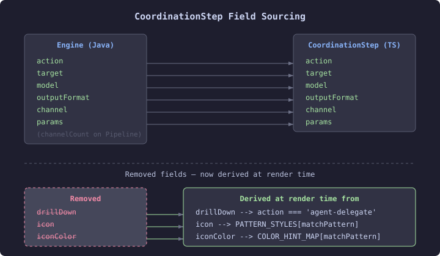

# The Issue Was Half Wrong — Sourcing CoordinationStep Fields

The coordination pipeline view renders step cards with six optional fields beyond the basics: `outputFormat`, `drillDown`, `icon`, `iconColor`, `channel`, and `channelCount`. The filed issue claimed all six had no YAML source and needed deciding — source them, keep them optional, or remove them as gallery fiction.

Three of those six are already in the engine's Java records. `CoordinationStepView` carries `outputFormat` and `channel`. `CoordinationPipelineView` carries `channelCount`. The server-side projection in `CoordinationPipelineProjection.java` populates them from the case definition's capabilities and channel config. The issue's table was wrong for half the fields — they just hadn't been traced back to the engine.

The other three — `drillDown`, `icon`, `iconColor` — genuinely have no source. But they aren't arbitrary either. Each encodes a rendering decision that can be derived from data already present.

## Drillability is an action-type property

`drillDown` was a boolean on each step: "can you click this to see agent detail?" It only makes sense for `agent-delegate` actions — rest calls and GraphQL queries don't have an agent to drill into. The fix is one expression:

```typescript
const canDrill = step.action === 'agent-delegate' && drillContext != null;
```

This replaces all the `step.drillDown` checks in the template — the `drillable` CSS class, the `role="button"`, the tabindex, the drill hint badge. The drillContext parameter already existed, threaded through from phase rendering and graph nodes. The boolean was redundant with information the renderer already had.

A side effect: `doc-classifier` (the first step in the KYC pipeline fixture) becomes drillable. It's an `agent-delegate` action that wasn't flagged `drillDown: true` in the old fixture — an oversight in hand-crafted demo data. Getting the derivation right made the fixture more honest.

## Match-case patterns already carry the semantic

The match-case routing in the pipeline view renders outcome steps — approve, escalate, reject — each with a custom icon (✓, ⚠, ✕) and color class (green, amber, red). These were explicit `icon` and `iconColor` fields on the step. But the graph model already had `COLOR_HINT_MAP` doing the same derivation from the pattern name:

```typescript
const COLOR_HINT_MAP: Record<string, 'green' | 'amber' | 'red'> = {
  approve: 'green',
  escalate: 'amber',
  reject: 'red',
};
```

We added a parallel `PATTERN_STYLES` map in the pipeline view for the lanes renderer and updated `renderMatchCase` to pass `c.pattern` through to the step card. The visual output is identical — the approve step still shows ✓ in green — but the icon and color derive from the match-case pattern, not from per-step fields that can't come from the server.



## The diff model got simpler too

The `compareStep` function in the coordination diff model was comparing `icon` and `iconColor` across pipeline versions. Since those fields no longer exist on the type, the comparison drops from five fields to three — `model`, `outputFormat`, `channel`. The fields that actually change when a pipeline definition evolves.

Nine files, net negative on lines. The type got three fields smaller. The renderer got slightly smarter about where visual properties come from. And the gallery fixtures stopped demonstrating fields that real YAML-sourced data could never populate.
