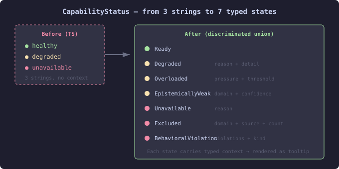

# Four Issues, Two Fixes, Two Closures — Model Alignment Day

A session that started as cleanup work turned into an archaeology expedition. The mosaic agent-viewer components were built from mockup descriptions and gallery fiction — TypeScript types that looked reasonable but hadn't been traced back to the engine's actual Java records. Four issues touched this problem; two needed code changes, two needed closing.

## The coordination fields were half right

Issue #263 listed six `CoordinationStep` fields as having "no YAML source." Three of them — `outputFormat`, `channel`, `channelCount` — are right there in `CoordinationStepView.java` and `CoordinationPipelineView.java`. The issue just hadn't traced them to the engine's coordination pipeline projection.

The other three — `drillDown`, `icon`, `iconColor` — were genuinely unsourced. But they weren't arbitrary. Each encoded a rendering decision derivable from data already present:

- Drillability is an action-type property: only `agent-delegate` steps have an agent to drill into
- Match-case icons (✓/⚠/✕) and colors derive from the case pattern name (`approve`/`escalate`/`reject`)
- The graph model already had `COLOR_HINT_MAP` doing exactly this derivation

Three fields removed from the type, three retained. Nine files, net negative on lines.

## PatternSpec was the wrong question

Issue #262 claimed 12 of 17 `PatternSpec` fields had "no equivalent in engine case definition YAML." The operative phrase was "case definition YAML." The fields aren't there — but that's because patterns live in the agency module, not the engine's case definition schema.

The Java `PatternSpec` sealed interface in `io.casehub.agency.core.yaml.spec` has eight record subtypes and models every single field the issue listed. `aggregation` (sealed interface with 4 subtypes), `termination` (12 subtypes), `routing` (5 subtypes), `governance`, `failurePolicy` — all present and richly typed. The fields enter the engine through `PatternWorkerFunctionProvider`, which reads a `"pattern"` key from raw worker JSON.

The real gap is a missing `PatternView` API projection. The data is modeled and compiled at runtime; it's just not exposed through REST. Filed as #294.

Issue #257 (align pattern views to real YAML) turned out to be already superseded by #283/#284, both closed. Closed it too.

## The eidos descriptor had drifted

Issue #256 was genuine. The `AgentDescriptor` TypeScript interface had 16 fields; the Java record has 30+. `AgentCapability` was missing epistemic domains, latency hints, cost hints, model refs. `AgentGoal` was missing lifecycle state and horizon. Most visibly, `HealthStatus` was a flat three-value string union (`healthy | degraded | unavailable`) where the Java side has a seven-state sealed hierarchy:

The difference matters for UI. `Degraded` carries a reason (`RATE_LIMITED`, `CONTEXT_EXHAUSTED`, `OVERLOADED`, `DOMAIN_MISMATCH`) and detail string. `EpistemicallyWeak` names the domain and confidence score. `Excluded` tracks whether the exclusion was `DECLARED` or `LEARNED`. A flat string throws all of this away; a discriminated union lets the health dot render a meaningful tooltip.

The type alignment was mechanical — add optional fields, match the Java shapes. The rendering change was the `healthColor` and `healthTooltip` functions that map each status variant to its color and human-readable description. Everything else renders gracefully when the new fields are absent, which is the right behaviour for fields that aren't populated until a `PatternView` API exists.

## The pattern

Three of four issues shared a root cause: types built from mockup descriptions rather than traced to Java records. The fix is the same each time — read the engine source, map field by field, remove what's invented, keep what's real. The interesting finding is how often "no source" turns out to mean "looked in the wrong module." The agency repo, the eidos API, the engine's projection layer — the data exists, it's just not always where you'd first look.
